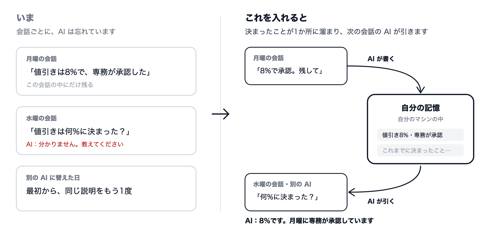
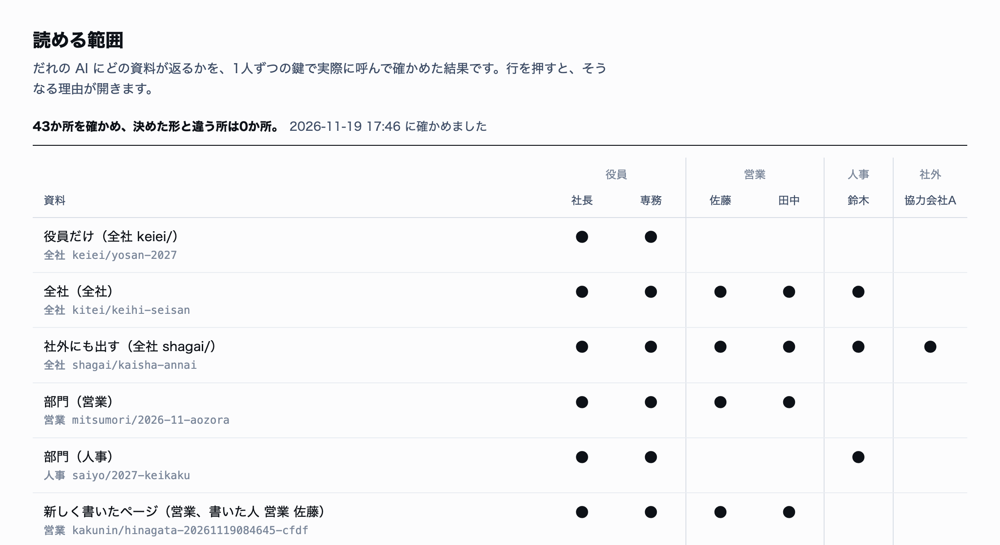

# Japan Company Brain

**AI に、同じ説明を二度しなくていい。**

昨日の会話で決めたことを、今日の会話の AI が覚えています。記憶を AI の外（自分のマシン）に置くので、AI を替えても同じ記憶を引けます。



- 会話で決まったことを AI に「残して」と頼むと、AI が自分の記憶に書きます
- 次の会話では、日本語の質問のまま探して答えます
- データは自分のマシンから出ません。1人で始めて、チームや会社にも広げられます

いま動くことを確かめてある AI は Claude Code です。ChatGPT・Gemini などは、これから順に確かめます（[つなげる AI](#つなげる-ai)）。

[1人で始める](#1人で始める) · [つなげる AI](#つなげる-ai) · [チームや会社で使う](#チームや会社で使う) · [サーバーに置く](guide/server.md) · [Issues](https://github.com/furuchanchan/japan-company-brain/issues)

[](LICENSE)
[](https://github.com/garrytan/gbrain)
[](https://github.com/furuchanchan/japan-company-brain/actions/workflows/selftest.yml)

## 1人で始める

要る物は Docker だけです。5分ほどで動きます。

```bash
git clone https://github.com/furuchanchan/japan-company-brain.git
cd japan-company-brain
```

メンバーを自分1人にした形が `sample/hitori.json` にあります。

```bash
./brain up                 # 立てる。初回は組み立てに数分かかります
cp sample/hitori.json config/company.json
./brain apply --yes        # 置き場と自分の鍵を作る
./brain connect watashi    # AI をつなぐコマンドが表示されます
```

つないだら、AI に「残しておいて」と頼むと書き、次の会話で質問すると探します。コマンドからも試せます。

```bash
./brain write watashi kimeta-1 "青空建設の値引き" "11月の見積は値引き8パーセントで、専務が承認した。"
./brain search watashi "青空建設の値引きは何パーセントに決まりましたか"
```

いま溜まるのは、AI に残すよう頼んだ事と、書き方の決まりに沿って AI が書いた事です。会話を丸ごと自動で取り込む所は、まだ作っていません。

## つなげる AI

つなぎ方は MCP（AI と外の道具をつなぐ共通の規格）です。確かめた物と、まだの物を分けて書きます。

| AI | 状態 |
|---|---|
| Claude Code | 確かめました（2.1.328。書く・探す・読める範囲） |
| ChatGPT・Gemini・Cursor・DeepSeek など | まだ確かめていません。MCP でつなげる道具から順に確かめ、結果をここに書きます |

つないで動いた・動かなかったの報告を [Issue](https://github.com/furuchanchan/japan-company-brain/issues/new/choose) にもらえると、とても助かります。

## できること

| | |
|---|---|
| **AI が書き足す** | 会話で決まったことを AI に書かせると、次の会話の AI や、同じ置き場のほかの人の AI が探せます |
| **日本語の質問で探す** | 「値引きの承認は誰がしますか」のような文のまま探せます |
| **書き方がちがっても探す** | 資料が「ＡＩ」「㈱山並商事」「令和8年」「髙橋」「営推」でも、「AI」「株式会社山並商事」「2026年」「高橋」「営業推進部」で当たります |
| **今ある資料を入れる** | Word・PDF・Excel・PowerPoint・テキスト（Shift_JIS も）を、フォルダに置くだけで取り込みます |
| **書き方の決まりを配る** | だれが・いつ・正式な名前で書く決まりを、1か所からつないだ AI に届けます |
| **自分のマシンで動く** | 資料・DB・鍵は立てたマシンに残ります。外のサービスへは何も送りません |

## チームや会社で使う

同じ置き場にメンバーそれぞれの AI をつなぐと、ほかの人の AI が決めたことも探せます。会社で使う時は、人ごとに読める範囲を分けられます。

| | |
|---|---|
| **人ごとに読める範囲が変わる** | 役員・部門・全社・社外の4段を、会社の形を書いた1つのファイルから入れます |
| **入れた権限を表で見る** | 1人ずつの鍵で実際に呼び、だれに何が返るかを1枚の表にします |
| **記録とバックアップ** | だれの鍵がいつ何をしたかを CSV に出せます。1つのファイルから復元できます |

### 見本の会社で試す

```bash
./brain up
./brain demo    # 見本の会社（6人・文書12件）を入れて動かす
```

`./brain demo` は、同じ質問を3人の鍵で投げ、営業の人の AI が書き足した決定を、営業と役員の鍵では探せて、人事の鍵では探せないことを見せます。見本には Word と PDF の資料（就業規則.docx・出張旅費規程.pdf）も入っています。

### 読める範囲

AI は、つないだ人の鍵で読める物だけを返します。読めない資料は「無い」と同じ答えになります。

| 段 | 読める物 | 書く先 |
|---|---|---|
| 役員 | 全社と全部門。役員だけのフォルダも読める | 全社 |
| 部門 | 自分の部門と全社。ほかの部門と役員だけのフォルダは読めない | 自分の部門 |
| 社外 | 全社のうち、名指ししたフォルダだけ | 書けない |

入れた結果は、次のような1枚の表で確かめられます（`./brain check --html`）。行が資料、列が人で、●はその人の AI に返る資料です。



### 自分の会社の形を入れる

1. `./brain up` で立てます
2. `config/company.example.json` を `config/company.json` に写し、部門とメンバーを書きます（項目の説明は [権限のひな形](kit/kengen-4dan/README.md)）
3. `docs/` の下に置き場ごとのフォルダを作り、資料を入れます。Markdown のほか、Word・PDF・Excel・PowerPoint・テキストをそのまま置けます（[今ある資料を入れる](guide/shiryo.md)）

   ```
   docs/zensha/   全社の資料（keiei/ は役員だけ、shagai/ は社外にも出す）
   docs/eigyo/    営業の資料
   docs/jinji/    人事の資料
   ```

4. 入れて、表で見ます

   ```bash
   ./brain apply --yes    # 会社の形を入れる（--yes を外すと下見）
   ./brain sync           # 資料を取り込む
   ./brain check          # 読める範囲の表を出す
   ```

5. 1人ずつ、AI をつなぐ鍵を作ります

   ```bash
   ./brain connect sato
   ```

   つなぐコマンドが表示されます。Claude Code なら次の形です。

   ```bash
   claude mcp add company-brain -t http http://127.0.0.1:3133/mcp -H "Authorization: Bearer <鍵>"
   ```

社内の略語（営推＝営業推進部）は `config/yure.json` に、AI が記録を書く時の決まりは `config/kakikata.md` に書けます（[日本語検索の直し](kit/nihongo-kensaku/README.md)・[書き方の決まり](kit/kakikata/README.md)）。

会社のみんなで使う時の置き方は [サーバーに置く](guide/server.md)、バックアップ・記録・人の出入りは [毎日の運用](guide/operations.md) にあります。コマンドの一覧は `./brain` で出ます。

## しくみ

```
各自の AI ──→ 日本語検索の中継 ──→ エンジン（gbrain）──→ Postgres
                質問文を語に分ける    鍵を確かめ、読める範囲で返す
                書き方の決まりを配る       ↑
Word・PDF・Excel・PowerPoint ──→ Markdown の写しにして取り込む
```

エンジンは [gbrain](https://github.com/garrytan/gbrain)（MIT License）です。コードは変えず、バージョンを指定して取り込みます。この一式は、日本の会社で使う時に要る物を周りに足しています。

| | gbrain をそのまま | この一式 |
|---|---|---|
| 日本語の質問文で探す | 文のままでは当たらない | 文のまま当たる |
| 全角と半角・異体字・(株)・和暦・社内の略語のちがい | 書き方がちがうと当たらない | そろえて当たる |
| Word・PDF・Excel・PowerPoint | 取り込まない（Markdown だけ） | サーバーの中で Markdown に変えて取り込む |
| 記録の書き方（だれが・いつ・正式な名前） | 案内は英語で、書き方の項目は無い | 日本語の決まりを全員の AI に配る |
| AI が書き足したページ | 書いた本人にしか返らない | 同じ部門と役員に返る |
| 権限を入れる | コマンドを順に実行する | 1つのファイルから入れ、表で見る（兼務も書ける） |

細かい説明は [今ある資料を入れる](guide/shiryo.md)・[日本語検索の直し](kit/nihongo-kensaku/README.md)・[書き方の決まり](kit/kakikata/README.md)・[権限のひな形](kit/kengen-4dan/README.md)・[確かめた範囲と、まだの所](guide/tested.md) にあります。

## コントリビュート

使ってみて困った所や足りない所を [Issue](https://github.com/furuchanchan/japan-company-brain/issues/new/choose) に書いてもらえるのが、いちばん助かります。直しを送る時は [CONTRIBUTING.md](CONTRIBUTING.md) を見てください。OSS を作るのはこれが初めてなので、OSS に詳しい方からの PR や、作法への指摘も歓迎です。

## セキュリティ

弱い所を見つけた時は、公開の Issue に書かず、[SECURITY.md](SECURITY.md) の手順で知らせてください。`.env`・`keys/`・`backup/` には鍵とパスワードが入るので、リポジトリに入れないでください。

## 作っている人

[Kotaro Furuno](https://github.com/furuchanchan) が個人で作っています。自分でも gbrain を毎日使っています。

gbrain の作者・運営元とは関係のない第三者が作っています。

## ライセンス

[MIT License](LICENSE) です。利用している部品のライセンスは [THIRD_PARTY.md](THIRD_PARTY.md) にあります。
